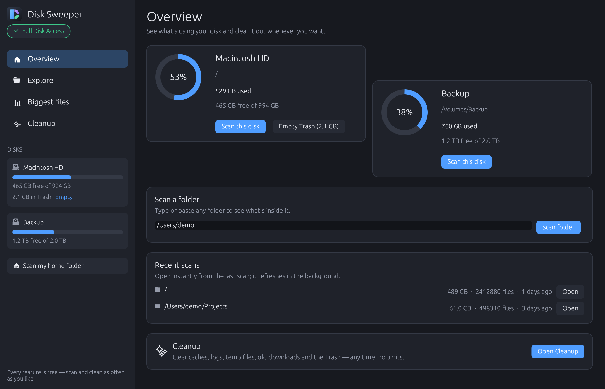
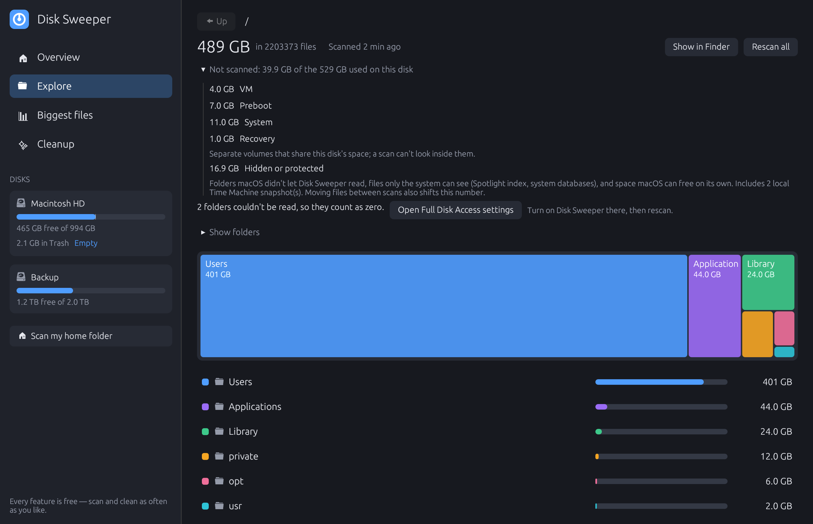
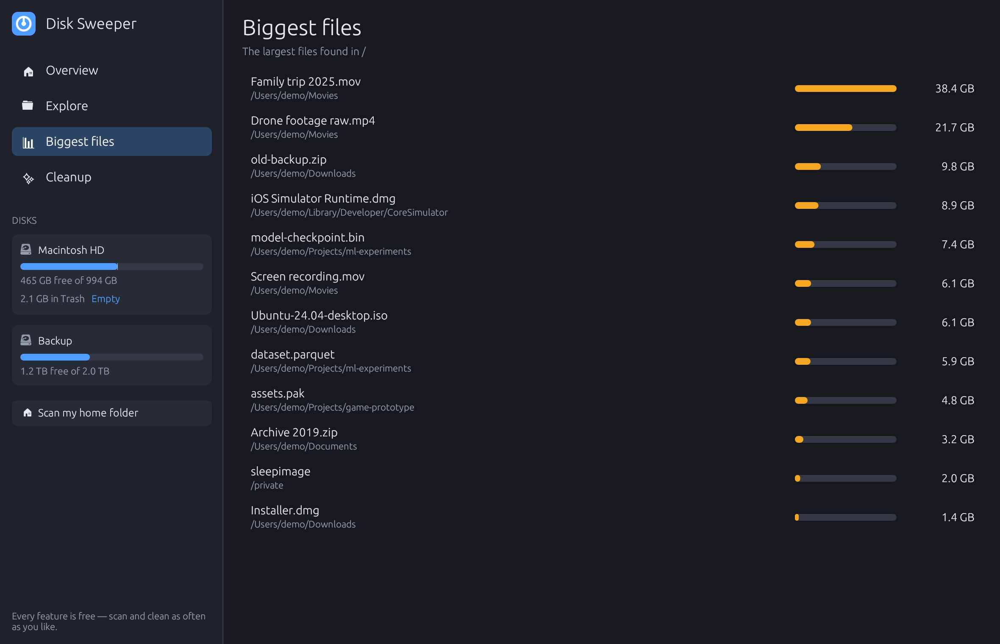
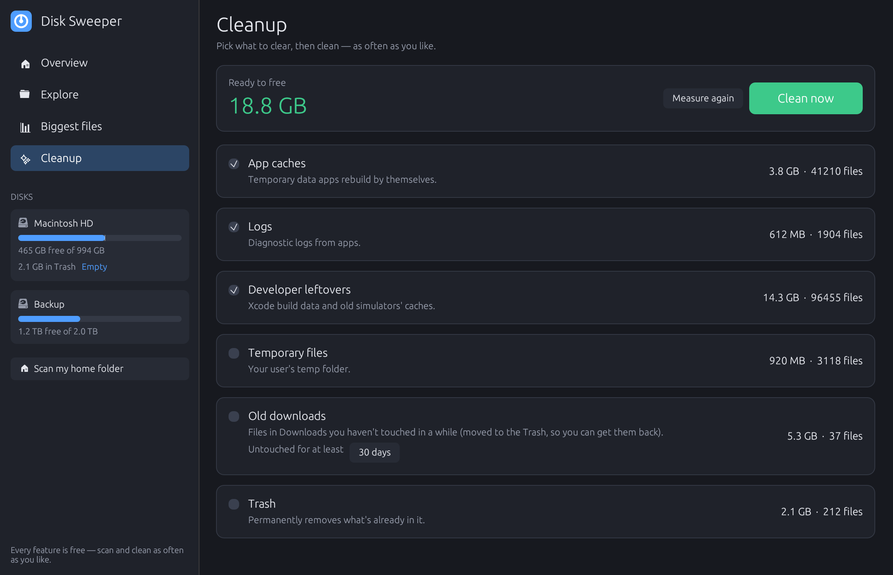
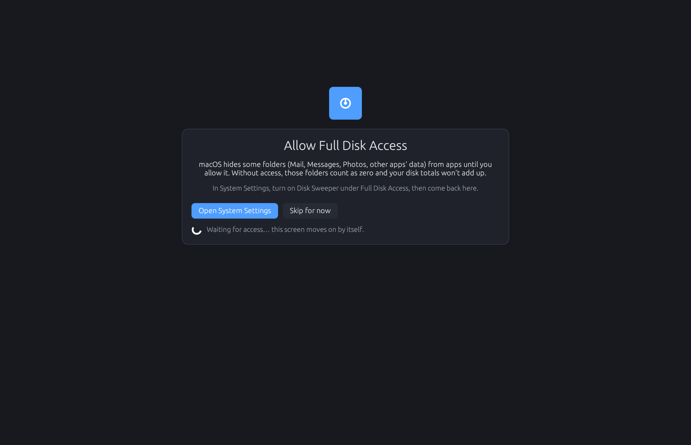

# Disk Sweeper

A small desktop app for macOS and Windows that shows what is using your disk and lets you clear
out what you don't need. It is written in Rust with [egui](https://github.com/emilk/egui).
Every feature is free: scan and clean as often as you like.



The screenshots use made-up demo data (see [Screenshots](#screenshots)).

## Features

- **Overview**: your disks with used and free space, the Trash or Recycle Bin size, and recent
  scans.
- **Explore**: a treemap and a sorted list of any disk or folder. Double-click to go into a folder,
  move items to the Trash, or show them in Finder or Explorer. Scans are saved, so reopening a disk
  shows the last result right away while a fresh scan runs in the background. You can rescan a
  single folder without rescanning the whole disk.
- **Biggest files**: the 200 largest files found by the scan.
- **Cleanup**: measures and clears app caches, logs, Xcode build data (macOS), temp folders,
  crash dumps and Explorer's thumbnail cache files (`thumbcache_*.db`, Windows), old downloads, and
  the Trash. Old downloads go to the Trash rather than being deleted. If you also pick the Trash,
  it is emptied first, so the downloads moved in that run can still be restored. Items moved to
  the Trash are reported separately from space actually freed.
- **"Not scanned" reconciliation**: after a whole-disk scan, Disk Sweeper compares what it found
  with the space the disk reports as used and explains the difference. Usually that is separate
  volumes the scan can't enter (on macOS: VM, Preboot, System, Recovery), folders it wasn't allowed
  to read, system-only files, and space macOS can free on its own, such as local Time Machine
  snapshots. Shared space (APFS clones, hard links) can make the scan count more than the disk
  uses; that shows up as a negative row. The rows always add up to the gap.
- **Onboarding**: on macOS, a first-run screen asks for Full Disk Access and offers to move the app
  to /Applications. On Windows, it explains that running as administrator lets it measure
  admin-only folders.

| Explore | Biggest files |
| --- | --- |
|  |  |
| **Cleanup** | **Full Disk Access onboarding** |
|  |  |

## Platform support

| Platform | Status |
| --- | --- |
| macOS 11+ (Apple Silicon) | Main development platform. |
| macOS (Intel) | Should work; not tested. |
| Windows 10/11 (x86_64) | Builds (cross-compiled from macOS), but untested on Windows. See the Recycle Bin note below. |
| Linux | Some code paths exist, but it isn't supported or tested. |

Limitations:

- Without Full Disk Access on macOS (or administrator rights on Windows), protected folders count
  as zero, so totals come up short. The app lists the folders it couldn't read.
- **Windows support is untested on real Windows machines.** Windows can't strictly guarantee that
  a delete goes to the Recycle Bin, so Disk Sweeper is defensive: it refuses to move an item
  unless it can confirm the item will go to the Recycle Bin. It checks for a fixed local drive with
  a Recycle Bin, that "delete immediately" is off (including by policy), and that the item fits the
  bin's size limit. If any of these is unknown, the item is left where it is and you get an error;
  delete it in Explorer if you're sure. It also vetoes any delete Windows announces as
  non-recycling. If Windows deletes something permanently anyway, the app shows an error and
  stops the rest of the cleanup.
- macOS protects some files (such as parts of Xcode simulators) so that they can't be moved to the
  Trash. For simulator runtimes the app offers to remove them through Xcode's own tool instead.
- Sizes are estimates when files share space on disk (APFS clones; on Windows, hard links among
  small files aren't checked, to keep scans fast).

## Building from source

You need Rust. `rust-toolchain.toml` pins the toolchain (currently 1.88.0) and rustup installs it
automatically.

```sh
cargo build --release
cargo test
./target/release/disk-sweeper
```

### macOS app bundle and Windows .exe

`tools/package.sh` builds both versions into `dist/`:

- `dist/Disk Sweeper.app` (macOS, signed; see below)
- `dist/Disk Sweeper.exe` (Windows, cross-compiled from macOS)

The Windows cross-build uses [zig](https://ziglang.org/) as the linker and dlltool, so neither
MinGW nor Visual Studio is needed:

```sh
tools/package.sh
```

The cross-build was tested with zig `0.11.0-dev.3382+c16d4ab9e`. Newer releases, including the
current Homebrew formula (`brew install zig`), haven't been verified; the shims may need changes
if zig's linker or dlltool flags have changed. Older and pinned releases are available from
[ziglang.org/download](https://ziglang.org/download/).

`tools/zig-win-cc.sh` and `tools/zig-dlltool.sh` adapt rustc's GNU-style linker and dlltool
arguments for zig. A plain `cargo build --target x86_64-pc-windows-gnu` needs the same two settings
that `package.sh` passes as environment variables (with absolute paths, because cargo runs rustc
from each dependency's folder):

```sh
CARGO_TARGET_X86_64_PC_WINDOWS_GNU_LINKER="$PWD/tools/zig-win-cc.sh" \
CARGO_TARGET_X86_64_PC_WINDOWS_GNU_RUSTFLAGS="-C dlltool=$PWD/tools/zig-dlltool.sh" \
  cargo build --release --target x86_64-pc-windows-gnu
```

You can put the same settings in a local, untracked `.cargo/config.toml` if you prefer.

On Windows you can build natively with `cargo build --release` (MSVC toolchain). This hasn't been
tested.

### Signing (macOS)

macOS ties privacy permissions such as Full Disk Access to the app's code signature.
`tools/package.sh` signs the bundle as follows:

- If `SIGN_IDENTITY` is set, it signs with that identity from your keychain, for example
  `SIGN_IDENTITY="Apple Development: Your Name (TEAMID)" tools/package.sh`. List your identities
  with `security find-identity -v -p codesigning`. The grant then survives rebuilds.
- Otherwise it signs ad hoc. An ad-hoc signature changes with every build, so macOS treats each
  rebuild as a new app and you'll need to turn Full Disk Access on again.

The bundle identifier is `local.disksweeper`. The app isn't notarized. If you download a build
made by someone else, macOS Gatekeeper will block it until you allow it in System Settings ›
Privacy & Security.

## Screenshots

The images in `docs/screenshots/` were made by the app itself, with made-up data so that no real
files or user names appear:

```sh
cargo build --release
for t in overview explore biggest cleanup setup-access; do
  ./target/release/disk-sweeper --screenshot "docs/screenshots/$t.png" --demo --tab $t
done
```

`--demo` only works together with `--screenshot`. The demo data is in `src/demo.rs`.

## Contributing

Issues and pull requests are welcome. Please keep changes small and focused, run `cargo test`
before you submit, and say which platform you tested on.

## License

Licensed under either of

- Apache License, Version 2.0 ([LICENSE-APACHE](LICENSE-APACHE))
- MIT license ([LICENSE-MIT](LICENSE-MIT))

at your option.

Unless you explicitly state otherwise, any contribution intentionally submitted for inclusion in
this work by you, as defined in the Apache-2.0 license, shall be dual licensed as above, without
any additional terms or conditions.
